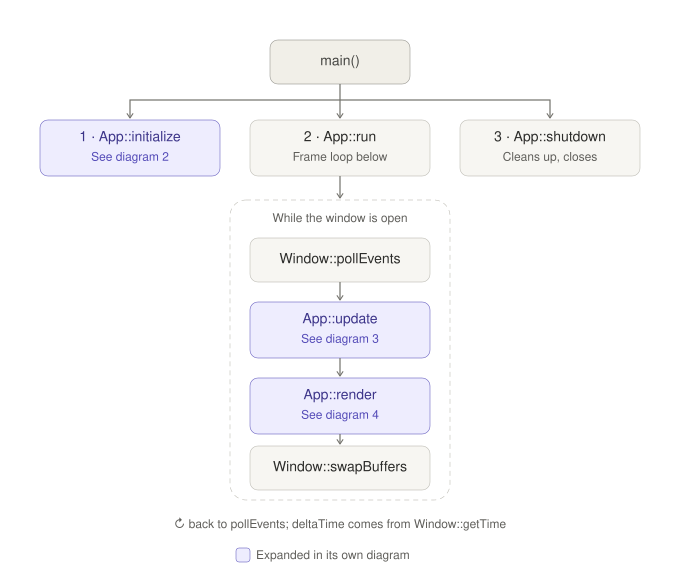
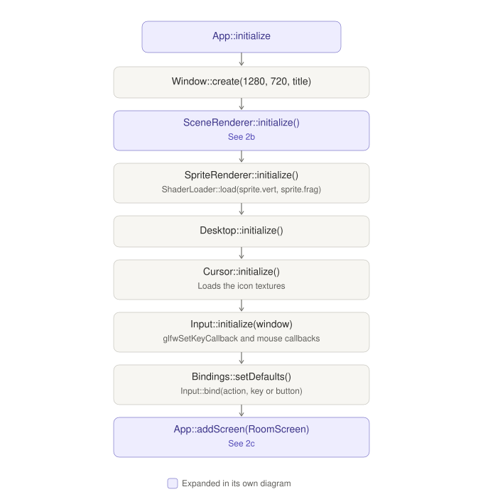
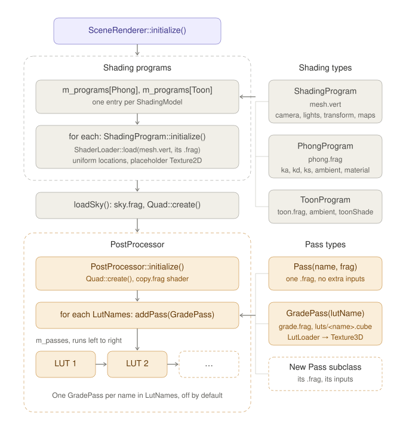
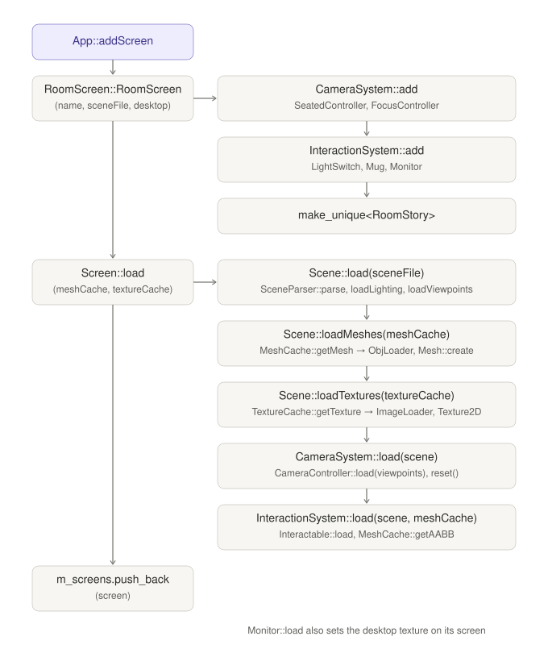
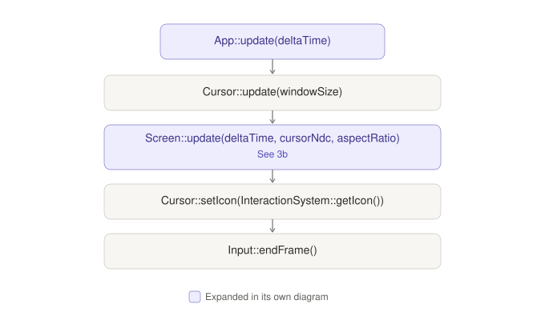
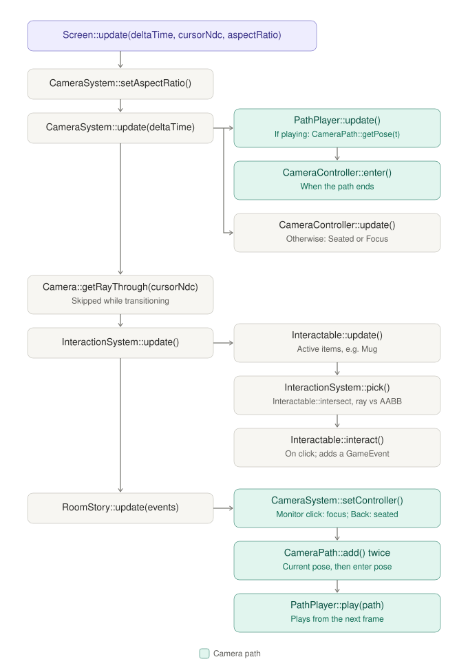
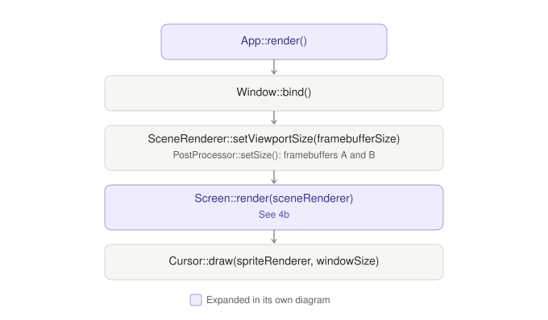
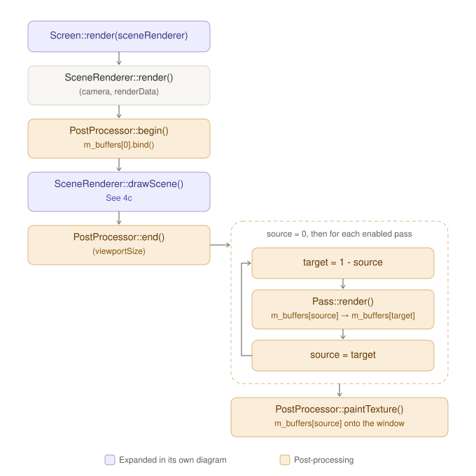
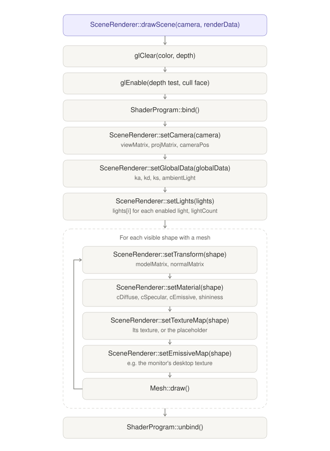

# Engine architecture

How the engine runs, from `main()` to one frame. Each diagram lists the calls in order as `Class::method()`. Amber marks post-processing; teal marks the camera path.

## 1. Overview

## 2. Initialize

### 2b. SceneRenderer::initialize

### 2c. App::addScreen

## 3. Update

### 3b. Screen::update

## 4. Render

### 4b. SceneRenderer::render

### 4c. SceneRenderer::drawScene

